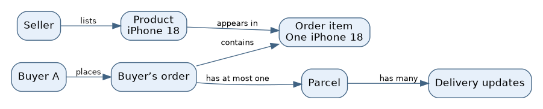
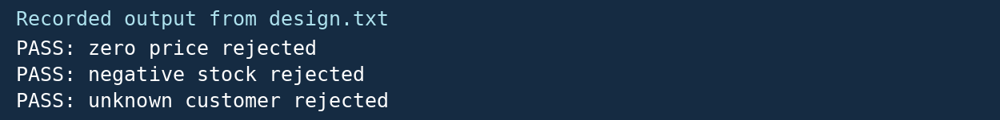

# 1. How the shop remembers an order

The brief asks for the case study, entity–relationship (ER) diagram, relational schema, keys, rules and normalisation.

I chose Temu, the popular online marketplace, as my case study. Buyers search and order products. Sellers list products and manage stock. Shop staff can read order records. In this example, a fictional seller lists an iPhone 18 at 450,000 Nigerian naira and has one left. I model the catalogue, stock, order lines and delivery tracking. Payments and carrier integration are outside this classroom exercise.

I chose the relational model in PostgreSQL because an order needs to connect the right buyer, products and parcel. A **primary key** identifies one row. A **foreign key** connects that row to a record that must already exist. A **constraint** is a rule the database checks when someone changes the data.

| Table | What one row means | Key and rules |
|---|---|---|
| Customers | One buyer | Customer ID identifies the buyer. A name is required. |
| Sellers | One shop | Seller ID identifies the shop. A shop name is required. |
| Products | One listing | Product ID identifies the listing. Seller ID links it to a shop. Price must be above zero and stock cannot be negative. |
| Orders | One checkout | Order ID identifies the order. Customer ID links it to the buyer. |
| Order items | One product on an order | Order ID and product ID together identify the line. Both links must exist. Quantity and recorded price must be positive. |
| Deliveries | One parcel for one order | Delivery ID identifies the parcel. Order ID links to Orders and is unique. The tracking code is also unique. |
| Delivery updates | One change in parcel status | Update ID identifies an event. Delivery ID links to the parcel. Each time is unique within that delivery. |

When Buyer A buys the iPhone 18, order 101 records the buyer and time. Its order line records product 1, quantity 1 and the price paid. The product table stores today's price. The order line keeps the checkout price even if today's price changes.

## Normalisation · Give each fact one home

Imagine Ada orders one iPhone and two power banks.

| Product on Ada’s order | Quantity |
|---|---:|
| iPhone | 1 |
| Power bank | 2 |

**First normal form.** I give the iPhone and the power bank their own rows. The quantity box on each row holds one number.

**Second normal form.** I write “2” on the power bank row for this order. I need both the order number and the product number to know what that “2” means. The order date only needs the order number, so I keep it in Orders.

**Third normal form.** I keep Ada’s name with her customer record. Her orders point to that record. If I spell her name wrong, I fix it once.

**Receipt price.** I keep the price Ada paid on her order line. Tomorrow’s shop price can change and her receipt still shows today’s price.

The test loaded 160,000 fictional products and rejected a zero price, negative stock and an order for an unknown buyer.

[SQL schema](Adebayo_Oluremi_301920976_schema.sql) · [Sample data](Adebayo_Oluremi_301920976_seed.sql) · [Rule checks](Adebayo_Oluremi_301920976_checks.sql) · [Recorded output](../evidence/Adebayo_Oluremi_301920976_design.txt)

