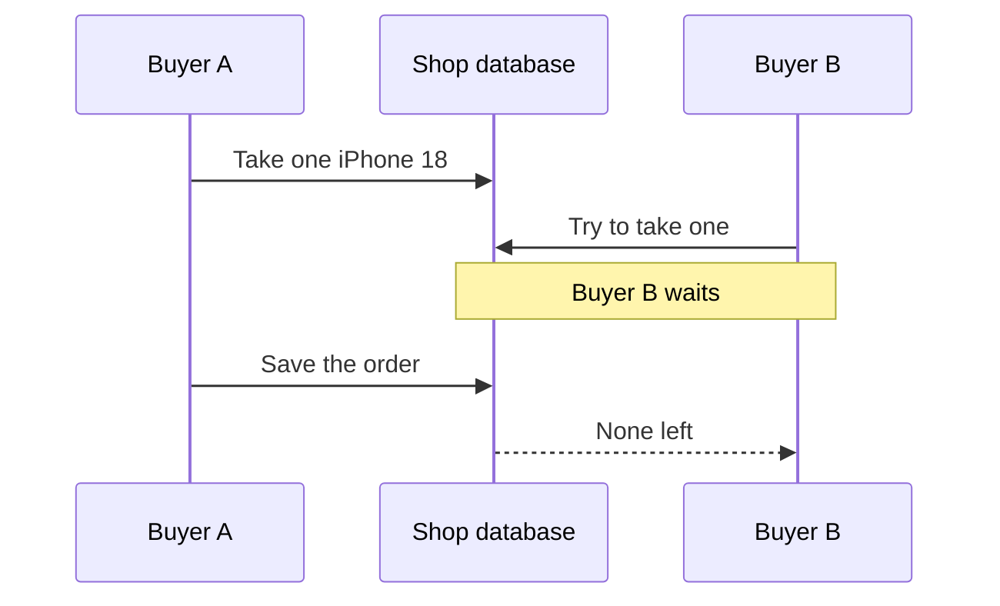
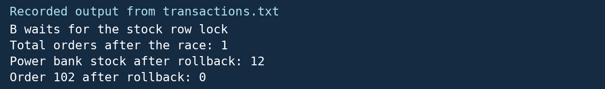

# 3. Who gets the last iPhone 18?

The brief asks for commit, rollback, isolation and a way to control two people trying to change the same record. A **transaction** groups changes together. **Commit** saves the group. **Rollback** undoes it.

1. Both buyers can see one iPhone 18 left on the shopping page.
2. Buyer A reaches checkout first. PostgreSQL holds the stock record while it prepares A’s order. Buyer B has to wait.
3. Before A saves the order, another connection sees the last saved stock count of one and cannot see A’s order. PostgreSQL calls this **Read Committed isolation**.
4. A saves the order and stock change together. B’s request checks stock again, finds zero and gets no phone. The log shows one saved order.

In a separate exercise there are 12 power banks. Preparing an order temporarily reduces that count to 11. I undo the unfinished order before saving it. This is called **rollback**. The count returns to 12 and the unfinished order is gone.

[Two-connection test](Adebayo_Oluremi_301920976_demo.py) · [Recorded output](../evidence/Adebayo_Oluremi_301920976_transactions.txt)

## After checkout

Order 101 can now be linked to delivery 501. The delivery test saves the parcel and its four sample events in one transaction. It then checks that a second parcel for the same order, an update for a missing parcel and an unsupported status are all rejected.

[Delivery test](Adebayo_Oluremi_301920976_delivery-demo.sql) · [Delivery output](../evidence/Adebayo_Oluremi_301920976_delivery.txt)
