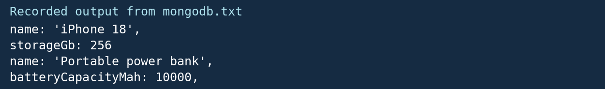

# 4. One product card with its own details

The brief asks for an example of a NoSQL model from the same case study, proof it worked and an explanation of why it fits. MongoDB stores the catalogue as **documents**, which work like product cards. The catalogue page can use one document to show a name, price and product details together. I chose the document model because different products need different fields.

| Product | Details on its card |
|---|---|
| iPhone 18 | Blue colour and 256 gigabytes of storage |
| Portable power bank | Battery capacity of 10,000 milliampere-hours and a Universal Serial Bus connector |

Selected fields from the returned iPhone 18 document:

```json
{
  "_id": 1,
  "name": "iPhone 18",
  "category": "Electronics",
  "priceNgn": 450000,
  "attributes": { "colour": "Blue", "storageGb": 256 }
}
```

The script saves the two cards using their product identifiers. It inserts them the first time and replaces the same cards on a repeat run. The Electronics search between 400,000 and 500,000 Nigerian naira returned the iPhone 18. The script also checked that the power bank card kept its own battery capacity field. This small document collection is a separate demonstration from the 160,000-row PostgreSQL benchmark.

This model lets a shop show different product details with the details that matter for each product. A real shop would refresh the cards when product details change. PostgreSQL still makes the final stock decision at checkout.

[MongoDB script](Adebayo_Oluremi_301920976_catalogue.js) · [Recorded documents and checks](../evidence/Adebayo_Oluremi_301920976_mongodb.txt)


